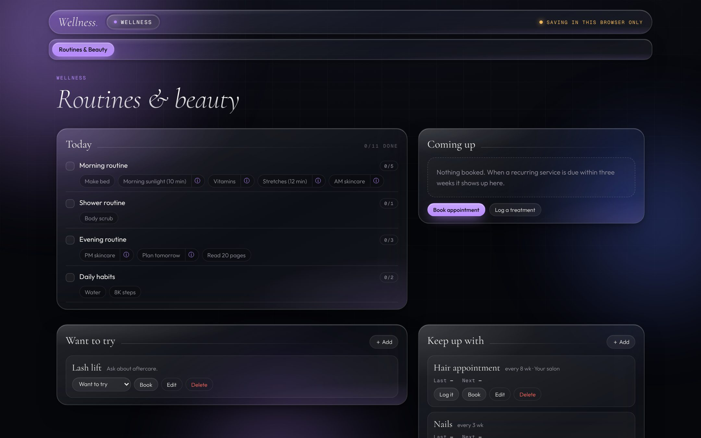
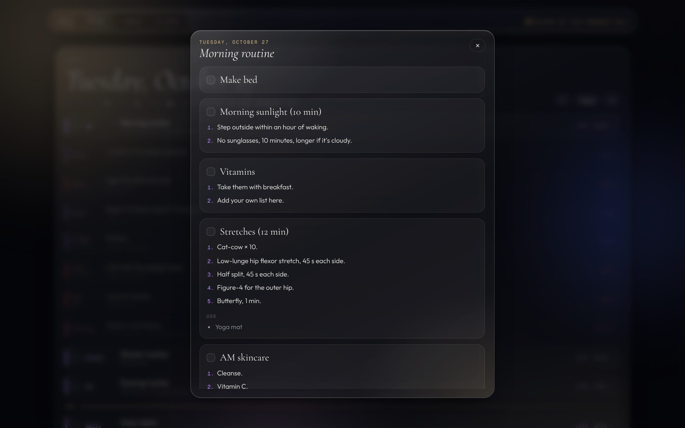

# Wellness Dashboard: Routines & Beauty

Part of [Pretty Technical](https://prettytechnicalclub.com). Just the wellness page from [HQ](https://github.com/prettytechnicalclub/hq), on its own: routines you tick off in one tap, follow-along how-tos, a beauty calendar and a weekly tracker.

**[Live demo](https://prettytechnicalclub.github.io/wellness-dashboard/?demo)** (sample data)

## What's inside

- **Today:** your habits grouped into Morning, Shower, Evening and Anytime. Tick a whole routine at once, or open it and tick one step at a time.
- **How-tos:** every habit can hold a video link, numbered steps and products. Tap "Stretches" and the routine is right there.
- **Days of the week:** put a habit only on the days you do it (hair wash Mon/Thu, scrub Tue/Sat).
- **Beauty calendar:** services you keep up with (hair, nails, brows) and when each is next due, a want-to-try list, a treatment log, and appointments you can add to Google Calendar.
- **Tracker:** a 7-day grid of everything, so you can see streaks and gaps.

## Use it

**In Claude (recommended).** Download `index.html`, upload it to Claude and say: *"Publish this as an artifact with the database and user capabilities, and connect Google Calendar."* It syncs across your phone and laptop.

**On its own.** Open `index.html` in a browser (or fork and turn on GitHub Pages). Saves in that browser.

## Make it yours

- Add, edit and delete routines in the app: scroll to **Daily routine**.
- Rename the page or change colors in `index.html`, or upload it to Claude and ask.
- Rather start from scratch? `prompts/wellness-dashboard.md` builds a page like this around your goals.
- Want routines built from videos you've saved? See [TikTok to Dashboard](https://github.com/prettytechnicalclub/tiktok-to-dashboard).

Nothing here is medical advice; check with a professional about anything that hurts or worries you. MIT licensed.
